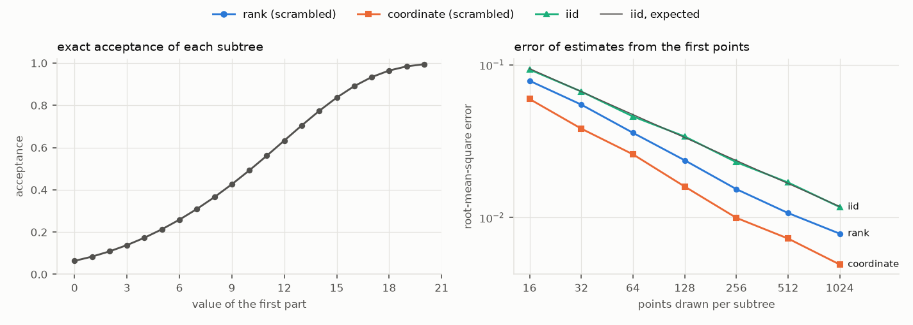

<!-- Generated by tools/make_sampling_report.py from docs/sampling.md.in and docs/sampling/records.json. Edit the template, not this file. -->

# Sampling report

This report documents how the library samples bounded compositions, why each
method behaves as it does, and how it measures. Sections 1 to 5 close phase 1:
sampling is to be understood, validated and signed off before any optimisation
is built on it. Section 6 covers the limits added in phase 2, still for
sampling only.

Measurements were taken on: 11th Gen Intel(R) Core(TM) i9-11980HK @ 2.60GHz, 16 hardware threads, gcc 15.2.0, optimised (release) build, library 0.0.1. Timings depend on the machine and
vary between sessions on it (they are medians within one session); the spread
results are deterministic.

## 1. Terms

- A **space** is the set of integer vectors `x` with `x[0] + ... + x[n-1] = K`
  and `lower[i] <= x[i] <= upper[i]`. Its **size** is the number of such vectors,
  its **compositions**. Section 6 adds limits on the nonzero parts and on the
  sums of groups of parts.
- The **rank** of a composition is its position in lexicographic order, first
  part slowest, counting from 0.
- A **region** is an interval of ranks. A **subtree** is the region of the
  compositions that share their first parts; it is contiguous in rank order.
- A **sequence** produces compositions one index at a time. Point `i` depends
  only on the space, the sequence kind, a seed and `i`, so drawing 1000 points
  and then 100 more gives exactly the first 1100.
- The **gap ratio** of N points is the largest gap between consecutive sampled
  ranks (counting the ends, rank -1 and rank `size`) times N / size. Evenly
  spaced points give 1. It measures spread in rank order only.
- The **marginal error** of N points is the largest difference, over every part
  and every value it can take, between the fraction of points with that value
  and the exact probability of that value under the uniform distribution. It
  measures spread part by part.

## 2. Counting and ranking

Let `N[i][k]` be the number of ways to place `k` into parts `i..n-1` within
their bounds (lower bounds shifted to zero). Then

    N[n][0] = 1,  N[n][k > 0] = 0,
    N[i][k] = N[i+1][k] + N[i+1][k-1] + ... + N[i+1][k - min(cap_i, k)].

The library stores the prefix sums `P[i][k] = N[i][0] + ... + N[i][k]`, so every
entry costs one subtraction and one addition: the table is built in O(n K)
multiprecision operations. The compositions whose part `i` takes value `v`
(with `k` left to place) number `N[i+1][k - v]`, and those with a smaller part
`i` number `P[i+1][k] - P[i+1][k - v]`. That makes lexicographic rank a sum of
one such term per part, and unranking one binary search per part. This is the
path-counting construction of H. S. Wilf, "A unified setting for sequencing,
ranking, and selection algorithms for combinatorial objects", Advances in
Mathematics 24 (1977) 281-291: compositions are the paths of a layered graph,
and rank is a position among them.

The tests check every rank of random small spaces against plain enumeration,
sizes against inclusion and exclusion, and multiprecision arithmetic against
Python's integers. A differential check, not in the repository, agreed with the
2013-2015 implementation on every rank it compared, on spaces where that code
is valid.

## 3. The sequences

### 3.1 `rank_sequence`: radical-inverse order on the ranks

This is the one-dimensional Halton (van der Corput) order applied to ranks:
the method the earlier implementation called Halton.

Let `m = max(1, bitlen(size - 1))`, so `2^(m-1) < size <= 2^m`. Raw index `t`
gives the m-bit value `X(t) = reverse_m(t)`, optionally XORed with a mask `M`
for scrambled replicates. Values `X(t) >= size` are skipped, and point `i` is
the rank of the `i`-th raw index that is kept. Put the other way round, the
sequence sorts the ranks `x` by their key `reverse_m(x ^ M)`.

**No repeats.** Bit reversal (and XOR with a fixed mask) is a bijection of the
m-bit values, so each rank appears for exactly one raw index. After `size`
points the whole space has been visited.

**Grid levels.** The first `2^j` raw indices give exactly the values whose
low `m - j` bits equal a fixed pattern (zero without a mask): an arithmetic
progression with step `2^(m-j)` and an offset below the step. The kept points
among them are the progression's terms below `size`, consecutive terms exactly
one step apart.

**Gap bound: every prefix of N points has gap ratio below 2.** For N >= 2,
let `j` be the largest level whose kept count `A_j` is at most N. The first N
points contain level `j`, whose terms are one step `2^(m-j)` apart, the first
below one step and the last within one step of `size`, so every gap is at
most `2^(m-j)`. Level `j + 1` has more than N kept terms, and it has at most
`ceil(size / 2^(m-j-1))` of them, so `N < 2 size / 2^(m-j)`. Together:
largest gap `<= 2^(m-j) < 2 size / N`. Measured worst case over all sample
sizes and spaces here: 1.90.

**Where the ratio is close to 1.** At a complete level (N equal to `A_j`) the
gap ratio is close to 1. At power-of-two sample sizes it is `2^m / size`
instead, between 1 and 2, because a level's kept count is about
`size / 2^(m-j)`, not a power of two. Measured against that value:

| space | measured at N = 1024 | 2^m / size |
|---|---:|---:|
| 6 parts | 1.56 | 1.56 |
| 8 parts | 1.49 | 1.49 |
| 30 parts, total near the cap sum | 1.69 | 1.69 |
| 100 parts (195-bit size) | 1.11 | 1.11 |

Scrambling shifts each level's progression without changing its step, so the
gaps keep their sizes while the points move. A level's kept count can differ
by one, so the two gap ratios are not equal by construction; in these
measurements they were equal at 64 of the 64
sample sizes.

**Random access.** Point `i` is found directly. The bits of its rank are fixed
from the lowest up, which are the key's most significant: at each bit, the
ranks on the side with key bit 0 form an arithmetic progression, so one
division counts them, and the search moves to the side that holds the `i`-th.
It stops when one rank is left, after at most 64 steps of 64-bit arithmetic.
So `seek`, `points(begin, count)` and threads need no shared state.

**Regions.** A region lists its ranks in the space's order: point `i` of a
region is its rank with the `i`-th smallest key, found by the same count
restricted to the interval. Three properties follow.

- *The gap bound holds inside every region.* Level `j`'s ranks in a region
  `[b, e)` are evenly spaced with step `2^(m-j)`, the first within one step of
  `b` and the last within one step of `e`, so the proof above applies to the
  region's level counts with `e - b` in place of `size`.
- *Any split of a region reproduces it.* A piece's sequence gives exactly the
  region's points in that piece, in the same order. `dyadic_split` cuts along
  the order's grid, the aligned blocks of `2^w` ranks, which the order visits
  in turn: blocks wholly inside the region hold equal shares, within one
  point, of every prefix of the region's sequence.
- *A region resumes where an outer sequence stopped.* The outer sequence's
  first N points that fall in the region are the region's first points.
  `overlap` counts them with a binary search on keys, and `resume_after` skips
  them, so the region continues without repeats and its new points fill the
  gaps between the old ones.

For regions wider than 64 bits a sequence holds fewer than `2^64` points:
with `f = bitlen(size - 1) - 64`, it lists the region's ranks congruent to `M`
modulo `2^f`, which have the smallest keys, and the same 64-bit search runs on
`x >> f`. A smaller region inside it starts with those points and continues
with the ranks between them.

### 3.2 `scaled_rank_sequence`: the earlier mapping

Point `i` is `floor(phi(i) size)`, with `phi` the base-2 radical inverse of the
64-bit index. The 2013-2015 code used it in two passes: first `2^k + 1`
evenly spaced ranks, close to this mapping's first `2^k` points, then this
mapping from index `2^k + 1` on, with the second pass sized from the share of
first-pass points that were accepted. `rank_sequence` does both passes as one
sequence: its first `2^j` points are an even grid and later points continue
it. The scaled mapping is kept for comparison only (section 8).

For `i < 2^j <= size`, the values `phi(i)` are the multiples of `2^-j`, at
least `size / 2^j >= 1` ranks apart after scaling, so the first
`2^floor(log2 size)` points never repeat, and at power-of-two sample sizes the
points are as evenly spaced as integers allow: measured gap ratio at most
1.07 at power-of-two N from 64 on. Past
`2^floor(log2 size)` points (at least half the space) it repeats ranks, it
never visits the whole space, and dyadic blocks do not reproduce it exactly.
Its worst gap ratio over all measured N is 1.96.

So in rank order, the two mappings differ in which sample sizes are "complete":
powers of two for the scaled mapping, the level counts `A_j` for
`rank_sequence`. Both stay below 2 for every N. `rank_sequence` keeps its
guarantees (no repeats, full coverage, exact region splits) at every N.

### 3.3 `coordinate_sequence`: Sobol points decoded part by part

Point `i` is the `i`-th Sobol point in `n - 1` dimensions (Joe and Kuo's
direction numbers, the set `scipy.stats.qmc` uses), passed to the unit-cube
decoder: part `i` takes the value whose share of the completions left after
parts `0..i-1` contains coordinate `i`, and the last part takes the rest.

Each coordinate of a Sobol sequence (unscrambled, or scrambled by a random
lower-triangular matrix and a digital shift) puts exactly one of the first
`2^j` points in each interval `[c / 2^j, (c + 1) / 2^j)`. The first part
depends on the first coordinate alone, so at every power-of-two N its value
counts are within two points of their exact expectation. Later parts depend
on several coordinates through the conditional shares; they keep a large part
of the advantage over independent draws (section 4) but carry no comparable
bound.

Distinct coordinates can decode to the same composition, so points can
repeat. Values whose conditional share is below `2^-64` cannot be reached.

### 3.4 `iid_sequence`: independent uniform draws

Point `i` is a uniform rank drawn by rejection from Philox4x64-10 (the
generator numpy also implements), keyed by the seed and counter `i`, then
unranked. Every composition has probability exactly `1 / size`. In the
logarithmic counting mode, where there are no ranks, it is the sequential
conditional draw through the decoder, uniform up to about `1e-12` relative
error.

### 3.5 Not repeating evaluated points

Repeats have three sources: a region sampled again from its start, a
different order (another seed, or a space with its parts reordered), and
sequences that repeat by design (coordinate, iid).

- *Same space and seed:* `resume_after` (section 3.1), with no stored state.
- *Anything else:* a `visited_set` holds the evaluated ranks exactly, one rank
  per entry, in hash tables split into shards with their own locks so that
  threads can share it. A `fresh_sampler` draws from a sequence, skips the
  visited points and marks the ones it hands out. A rank sequence covers its
  region, so the sampler ends exactly when every point of the region is
  visited, having passed each visited point once.
- *Small regions with coordinate or iid sequences:* those repeat and can miss
  points, so after `patience` visited points in a row (1024 by default) the
  sampler moves to the region's rank sequence, which lists what is left.

Threads can share one sampler: each takes its points with one atomic step on
the sequence's position, and the set decides which thread keeps a point.

## 4. Measured spread

Four spaces:

| space | parts | total | bounds | size |
|---|---:|---:|---|---|
| small | 6 | 30 | each part 0..12 | 168518 |
| medium | 8 | 40 | parts 0..20, 0..15, 0..25, 0..10, 0..30, 0..12, 0..18, 0..40 | 44954643 |
| near_cap | 30 | 590 | each part 0..20 | 635745396 |
| wide | 100 | 100 | each part 0..100 | 4.527e+58 |

Every sequence is measured at 16 sample sizes, powers of two and
others, from one draw of 16384 points per sequence (prefixes of a sequence
are its smaller samples).

### 4.1 Rank order


The rank sequences stay below 2 at every N, as section 3.1 proves; the scaled
mapping reaches about 1 at powers of two. Coordinate sequences and independent
draws are not built for rank order and leave much larger gaps (worst measured:
coordinate 13.0, independent 11.8).

### 4.2 Part by part


The grey line is `1 / sqrt(N)`, the order of independent sampling error. The
coordinate sequence has the smallest marginal error in most cases. On the
100-part space at N = 16384: coordinate 0.00527, rank
0.0100, independent 0.0115.


Per part, average of each part's largest error on the 100-part space at
N = 16384:

| parts | rank | coordinate (scrambled) | iid |
|---|---:|---:|---:|
| 0 to 9 | 0.00197 | 0.000342 | 0.00396 |
| 10 to 49 | 0.00400 | 0.00104 | 0.00463 |
| 50 to 99 | 0.00397 | 0.00213 | 0.00462 |

Rank order beats independent draws clearly only on the leading parts, as
section 3.1 implies; past them it is close to independent draws. The
coordinate sequence stays below independent draws on every range of parts,
but its advantage shrinks along the part order. Two likely reasons, not
measured separately here: later parts depend on more coordinates through the
conditional shares, and the joint projections of later Sobol coordinates are
less uniform than those of the first ones. In both orders, the part order
given to the space matters.

### 4.3 Repeats

Rank sequences never repeat. On the 6-part space, where 16384 points are
10% of all compositions, the scrambled coordinate sequence
gave 98.2% distinct points and independent draws
95.2%.

### 4.4 Tables

Small space (18-bit size):

*Largest rank gap times N / size*

| sequence | N = 100 | N = 1024 | N = 1100 | N = 16384 |
|---|---:|---:|---:|---:|
| rank | 1.22 | 1.56 | 1.67 | 1.56 |
| rank_scrambled | 1.22 | 1.56 | 1.67 | 1.56 |
| coordinate | 3.25 | 3.52 | 3.77 | 6.61 |
| coordinate_scrambled | 2.90 | 5.56 | 4.68 | 6.32 |
| iid | 4.26 | 9.36 | 8.95 | 10.7 |
| scaled_rank | 1.56 | 1.00 | 1.08 | 1.07 |

*Largest marginal error (any part, any value)*

| sequence | N = 100 | N = 1024 | N = 1100 | N = 16384 |
|---|---:|---:|---:|---:|
| rank | 0.0637 | 0.0214 | 0.0202 | 0.00375 |
| rank_scrambled | 0.0569 | 0.0153 | 0.0164 | 0.00400 |
| coordinate | 0.0556 | 0.0176 | 0.0172 | 0.00382 |
| coordinate_scrambled | 0.0556 | 0.0226 | 0.0184 | 0.00256 |
| iid | 0.0711 | 0.0374 | 0.0398 | 0.00436 |
| scaled_rank | 0.0582 | 0.0139 | 0.0135 | 0.00546 |

*Distinct points*

| sequence | N = 100 | N = 1024 | N = 1100 | N = 16384 |
|---|---:|---:|---:|---:|
| rank | 100 | 1 024 | 1 100 | 16 384 |
| rank_scrambled | 100 | 1 024 | 1 100 | 16 384 |
| coordinate | 100 | 1 024 | 1 100 | 16 154 |
| coordinate_scrambled | 100 | 1 024 | 1 100 | 16 082 |
| iid | 100 | 1 019 | 1 095 | 15 601 |
| scaled_rank | 100 | 1 024 | 1 100 | 16 384 |

Medium space (26-bit size):

*Largest rank gap times N / size*

| sequence | N = 100 | N = 1024 | N = 1100 | N = 16384 |
|---|---:|---:|---:|---:|
| rank | 1.17 | 1.49 | 1.60 | 1.49 |
| rank_scrambled | 1.17 | 1.49 | 1.60 | 1.49 |
| coordinate | 3.24 | 3.81 | 4.09 | 6.60 |
| coordinate_scrambled | 2.92 | 4.74 | 4.07 | 8.01 |
| iid | 4.56 | 7.32 | 7.87 | 10.4 |
| scaled_rank | 1.56 | 1.00 | 1.07 | 1.00 |

*Largest marginal error (any part, any value)*

| sequence | N = 100 | N = 1024 | N = 1100 | N = 16384 |
|---|---:|---:|---:|---:|
| rank | 0.0676 | 0.0247 | 0.0215 | 0.00598 |
| rank_scrambled | 0.0543 | 0.0169 | 0.0152 | 0.00461 |
| coordinate | 0.0593 | 0.0181 | 0.0184 | 0.00330 |
| coordinate_scrambled | 0.0574 | 0.0175 | 0.0154 | 0.00250 |
| iid | 0.0639 | 0.0227 | 0.0238 | 0.00702 |
| scaled_rank | 0.0829 | 0.0174 | 0.0158 | 0.00636 |

*Distinct points*

| sequence | N = 100 | N = 1024 | N = 1100 | N = 16384 |
|---|---:|---:|---:|---:|
| rank | 100 | 1 024 | 1 100 | 16 384 |
| rank_scrambled | 100 | 1 024 | 1 100 | 16 384 |
| coordinate | 100 | 1 024 | 1 100 | 16 383 |
| coordinate_scrambled | 100 | 1 024 | 1 100 | 16 384 |
| iid | 100 | 1 024 | 1 100 | 16 382 |
| scaled_rank | 100 | 1 024 | 1 100 | 16 384 |

Near-cap space (30-bit size):

*Largest rank gap times N / size*

| sequence | N = 100 | N = 1024 | N = 1100 | N = 16384 |
|---|---:|---:|---:|---:|
| rank | 1.32 | 1.69 | 1.81 | 1.69 |
| rank_scrambled | 1.32 | 1.69 | 1.81 | 1.69 |
| coordinate | 4.53 | 4.58 | 4.92 | 9.10 |
| coordinate_scrambled | 5.59 | 8.24 | 6.83 | 9.11 |
| iid | 4.73 | 8.66 | 6.33 | 11.4 |
| scaled_rank | 1.56 | 1.00 | 1.07 | 1.00 |

*Largest marginal error (any part, any value)*

| sequence | N = 100 | N = 1024 | N = 1100 | N = 16384 |
|---|---:|---:|---:|---:|
| rank | 0.0736 | 0.0287 | 0.0266 | 0.00885 |
| rank_scrambled | 0.0664 | 0.0269 | 0.0246 | 0.00561 |
| coordinate | 0.0643 | 0.0160 | 0.0170 | 0.00336 |
| coordinate_scrambled | 0.0543 | 0.0192 | 0.0152 | 0.00293 |
| iid | 0.0936 | 0.0494 | 0.0434 | 0.0104 |
| scaled_rank | 0.106 | 0.0258 | 0.0218 | 0.00720 |

*Distinct points*

| sequence | N = 100 | N = 1024 | N = 1100 | N = 16384 |
|---|---:|---:|---:|---:|
| rank | 100 | 1 024 | 1 100 | 16 384 |
| rank_scrambled | 100 | 1 024 | 1 100 | 16 384 |
| coordinate | 100 | 1 024 | 1 100 | 16 384 |
| coordinate_scrambled | 100 | 1 024 | 1 100 | 16 384 |
| iid | 100 | 1 024 | 1 100 | 16 384 |
| scaled_rank | 100 | 1 024 | 1 100 | 16 384 |

Wide space (195-bit size):

*Largest rank gap times N / size*

| sequence | N = 100 | N = 1024 | N = 1100 | N = 16384 |
|---|---:|---:|---:|---:|
| rank | 1.73 | 1.11 | 1.19 | 1.11 |
| rank_scrambled | 1.73 | 1.11 | 1.19 | 1.11 |
| coordinate | 2.91 | 5.03 | 5.19 | 9.53 |
| coordinate_scrambled | 2.48 | 5.36 | 4.80 | 10.5 |
| iid | 3.46 | 5.62 | 6.04 | 10.1 |
| scaled_rank | 1.56 | 1.00 | 1.07 | 1.00 |

*Largest marginal error (any part, any value)*

| sequence | N = 100 | N = 1024 | N = 1100 | N = 16384 |
|---|---:|---:|---:|---:|
| rank | 0.123 | 0.0446 | 0.0433 | 0.0100 |
| rank_scrambled | 0.131 | 0.0437 | 0.0415 | 0.00988 |
| coordinate | 0.0987 | 0.0237 | 0.0267 | 0.00790 |
| coordinate_scrambled | 0.0713 | 0.0202 | 0.0169 | 0.00527 |
| iid | 0.121 | 0.0432 | 0.0358 | 0.0115 |
| scaled_rank | 0.143 | 0.0445 | 0.0434 | 0.0114 |

*Distinct points*

| sequence | N = 100 | N = 1024 | N = 1100 | N = 16384 |
|---|---:|---:|---:|---:|
| rank | 100 | 1 024 | 1 100 | 16 384 |
| rank_scrambled | 100 | 1 024 | 1 100 | 16 384 |
| coordinate | 100 | 1 024 | 1 100 | 16 384 |
| coordinate_scrambled | 100 | 1 024 | 1 100 | 16 384 |
| iid | 100 | 1 024 | 1 100 | 16 384 |
| scaled_rank | 100 | 1 024 | 1 100 | 16 384 |

### 4.5 Regions after the whole space

Each space's first 4096 rank-sequence points, then every subtree
one level down resumed for up to 256 more points:

| space | subtrees | points added | repeats | worst gap ratio inside a subtree |
|---|---:|---:|---:|---:|
| 6 parts | 13 | 3328 | 0 | 1.82 |
| 8 parts | 21 | 5376 | 0 | 1.94 |
| 30 parts, total near the cap sum | 11 | 2333 | 0 | 1.96 |
| 100 parts (195-bit size) | 101 | 25444 | 0 | 1.99 |

The gap ratio is taken inside each subtree over all its points, old and new,
for the subtrees holding at least two. It stays below 2, as section 3.1
proves for any prefix of a region's sequence.

A `fresh_sampler` on the subtree with prefix (5, 5, 5) of the small space
(118 compositions), after the space's first 16384 points
were marked visited, 11 of them inside the subtree:

| source | points handed out | visited points passed over | moved to rank order |
|---|---:|---:|---|
| rank | 107 | 11 | no |
| coordinate_scrambled | 107 | 1477 | yes |
| iid | 107 | 1509 | yes |

## 5. Performance

### 5.1 Threads

Million points of the 100-part space per second, 200 000 points
per call, median of 3 runs:

| sequence | 1 thread | 2 threads | 4 threads | 8 threads | 16 threads |
|---|---:|---:|---:|---:|---:|
| rank | 0.269 | 0.534 | 1.05 | 1.52 | 1.86 |
| coordinate_scrambled | 0.209 | 0.354 | 0.693 | 1.04 | 1.33 |
| iid | 0.310 | 0.620 | 1.05 | 1.38 | 1.93 |


One thread produces 0.269 million rank-sequence points per second; 8 threads
give 5.7 times that and 16 hardware threads
6.9 times. Every point is independent, so threads share
nothing but the read-only table and an atomic block counter.

### 5.2 Tables and memory

| counting | parts | total | upper bound | build ms | table MiB | log size |
|---|---:|---:|---:|---:|---:|---:|
| exact | 10 | 100 | 100 | 0.0660 | 0.00848 | 29.1 |
| exact | 100 | 100 | 100 | 0.359 | 0.187 | 135 |
| exact | 100 | 1000 | 1000 | 3.50 | 3.68 | 330 |
| exact | 1000 | 1000 | 1000 | 166 | 156 | 1382 |
| logarithmic | 10 | 100 | 100 | 0.0832 | 0.0182 | 29.1 |
| logarithmic | 100 | 100 | 100 | 0.645 | 0.167 | 135 |
| logarithmic | 100 | 1000 | 1000 | 5.57 | 1.64 | 330 |
| logarithmic | 1000 | 1000 | 1000 | 50.4 | 16.3 | 1382 |
| logarithmic | 2000 | 2200 | 2200 | 287 | 71.4 | 2901 |
| logarithmic | 3000 | 3000 | 3000 | 588 | 146 | 4154 |

The exact table grows as `n K` entries times the limb width of the counts. At
1000 parts with total 1000 it takes 156 MiB, against
16.3 MiB in the logarithmic mode, which stores two doubles and a
byte per entry (the byte marks the entries with completions, which rounded
logarithms cannot tell from zero).

### 5.3 Single operations (100-part space)

| operation | microseconds per call |
|---|---:|
| unrank | 3.01 |
| rank | 4.08 |
| decode_exact | 3.94 |
| decode_log | 3.61 |
| encode_exact | 263 |
| encode_log | 14.2 |

Unranking takes 3.01 microseconds. `encode` is far slower,
263 microseconds exactly and 14.2 in logarithms,
because it binary-searches each coordinate with a heap allocation per step.
It is called once per point handed back from an optimiser; an allocation-free
version is possible if it becomes a bottleneck.

## 6. Constrained spaces

Phase 2 adds limits beyond the bounds. The ones in section 6.1 are counted
exactly, by an extension of section 2, so what sections 3 to 5 describe works
on a constrained space too: sizes, ranks, regions, every sequence,
`fresh_sampler` and the logarithmic mode. Limits the
table does not count go through a filter (section 6.4), and `repair` (section
6.5) moves a point from outside the space to the nearest one inside.

### 6.1 Limits

| limit | a composition is kept when | given by |
|---|---|---|
| nonzero count | `min_count <= #{i : x[i] != 0} <= max_count` | `support_limits` |
| semicontinuous parts | `x[i] == 0` or `abs(x[i]) >= min_size[i]` | `support_limits` |
| group sums | `min_sum <= sum of x[i] over the group's parts <= max_sum` | `group_limit`, any number of them |

A group can be any set of parts: groups can be disjoint, nested, or crossing
(overlapping without one holding the other), and a group's parts need not be
adjacent. Compositions stay in lexicographic order of the parts (section 8),
so a subtree is still a contiguous region, and `subspace` gives the remaining
parts as a space with the limits left for them.

### 6.2 Counting with layers

In section 2 the completions of parts `i..n-1` depend only on `k`, what is
left to place. Under these limits they also depend on the parts already
placed, so each row gets **layers**, one for each state the walk has to
remember, and the count becomes `N[i][c][k]` for layer `c`:

- *Nonzero count:* the number of nonzero parts so far, from 0 to
  `min(max_count, n)`. Row `n` counts 1 only in the layers from `min_count` to
  `max_count`.
- *Semicontinuous parts:* no state, but part `i`'s values split into up to
  three **segments**: the negative values up to `-min_size[i]`, zero, and the
  positive values from `min_size[i]`. With a nonzero count, the two nonzero
  segments add one to it.
- *Groups:* a group is **open** at row `j` when it has members both before
  part `j` and from part `j` on. Each open group adds a coordinate to the
  layer: `r`, the group's sum so far above its members' lower bounds, or
  `r + k` when part `j - 1` is a member.

The second form is what keeps the prefix sums of section 2 usable. All
values `y` of one segment of part `i` lead to the same layer of row `i + 1`:
the nonzero count moves the same way for the whole segment, a member's value
turns `(r, k)` into `(r + y, k - y)`, whose sum `r + k` does not depend on
`y`, and a part outside the group leaves `r` alone. So

    N[i][c][k] = sum over the segments s of part i, and y from a_s to b_s, of N[i+1][c_s][k - y],

where `[a_s, b_s]` are the values segment `s` allows from `(c, k)` and `c_s`
is the layer they lead to. Each segment's term is one window of the prefix
sums of row `i + 1` in one layer, as in section 2: rank adds one window per
part, and unranking picks a segment, then searches inside it. A group's limits
only narrow `[a_s, b_s]`: a member can add at most `max_sum - r` (in shifted
terms), and the group's last member must bring it to at least `min_sum`.

**Cost.** Each layer of a row holds `K + 1` entries, `K` being the total less
the lower bounds. The layers of a row are a product of factors:
`min(max_count, n) + 1` for the nonzero count, and for each open group `K + 1`
if the part before is a member, or the group's largest shifted sum plus 1 if it
is not. Groups of adjacent parts that do not overlap are open one at a time, so
they cost one factor per row; nested and crossing groups are open together,
and their factors multiply. Construction refuses tables of more than 2^28
entries.

Measured on 30 parts summing to 100, each
`0..20`, under each kind of limit (sizes rounded; build times
are the median of three):

| space | limits | size | layers per row, at most | table MiB | build ms | logarithmic table MiB | build ms |
|---|---|---:|---:|---:|---:|---:|---:|
| base | none | 5.53e+28 | 1 | 0.0347 | 0.0695 | 0.0512 | 0.229 |
| count | 5 to 12 nonzero parts | 3.26e+21 | 13 | 0.431 | 1.54 | 0.666 | 4.01 |
| min_size | each part 0 or at least 3 | 3.73e+23 | 1 | 0.0324 | 0.110 | 0.0512 | 0.368 |
| support | 5 to 12 nonzero parts; each part 0 or at least 3 | 2.69e+20 | 13 | 0.391 | 1.63 | 0.666 | 4.05 |
| groups | 6 groups of 5 adjacent parts, each summing to 10..30 | 1.29e+28 | 101 | 2.65 | 6.88 | 4.02 | 5.04 |
| nested | 6 groups of 5 adjacent parts, each summing to 10..30; 2 groups of 15 adjacent parts, each summing to 40..60 | 1.15e+28 | 10 201 | 260 | 1013 | 405 | 528 |
| crossing | parts 10 to 19 summing to 20..40; the even parts summing to 40..60 | 2.79e+28 | 10 201 | 72.7 | 358 | 128 | 257 |
| combined | 5 to 12 nonzero parts; each part 0 or at least 3; 6 groups of 5 adjacent parts, each summing to 10..30 | 1.36e+19 | 1 313 | 27.4 | 142 | 52.2 | 106 |

The nonzero count multiplies the layers by its range, 13, and
semicontinuous parts add nothing to the table. Groups of adjacent parts give
101 layers (`K + 1`) and 2.65 MiB. Nesting them in two
halves multiplies two such factors: 10 201 layers, 260
MiB, 1013 ms to build. The crossing pair reaches
10 201 layers where both are open, 72.7 MiB in all.
The logarithmic tables store two doubles and a byte per entry and grow the
same way.

Single operations, microseconds per call (repair targets drawn uniformly per
part from 0 to twice the average part):

| space | unrank | rank | decode | decode (logarithmic) | repair |
|---|---:|---:|---:|---:|---:|
| base | 0.937 | 1.26 | 1.08 | 2.29 | 3.90 |
| count | 1.43 | 2.30 | 1.40 | 5.15 | 1025 |
| min_size | 1.22 | 2.06 | 1.39 | 5.10 | 72.8 |
| support | 1.17 | 1.90 | 1.27 | 4.83 | 933 |
| groups | 1.60 | 2.50 | 1.50 | 2.13 | 2869 |
| nested | 1.82 | 3.25 | 1.85 | 2.53 | 281656 |
| crossing | 2.09 | 3.65 | 2.12 | 3.47 | 115347 |
| combined | 1.80 | 2.71 | 1.80 | 6.16 | 50159 |

Unranking takes at most 2.2 times as long as without limits:
its search runs inside one layer whatever the number of layers, and the extra
work is choosing a segment and finding the next layer, part by part.

### 6.3 Sampling

The sequences need nothing new. A rank sequence lists ranks, so the gap bound
of section 3.1 holds on a constrained space as on any other, and so do exact
region splits and resuming. The decoder gives each part's allowed values their
exact conditional shares, segment by segment, so the coordinate sequence's
first part keeps its bound of section 3.3. Independent draws pick a uniform
rank, so they stay exactly uniform.

On the spaces of section 6.2 at N = 16384 (exact marginals propagated
through the layers of the logarithmic tables, and checked against exact
subtree counts for the first and last parts):

*Largest rank gap times N / size*

| space | rank | rank_scrambled | coordinate_scrambled | iid |
|---|---:|---:|---:|---:|
| base | 1.43 | 1.43 | 6.31 | 11.5 |
| count | 1.45 | 1.45 | 6.32 | 10.9 |
| min_size | 1.62 | 1.62 | 8.53 | 9.61 |
| support | 1.10 | 1.10 | 7.67 | 9.40 |
| groups | 1.54 | 1.54 | 9.37 | 9.69 |
| nested | 1.72 | 1.72 | 9.42 | 9.33 |
| crossing | 1.42 | 1.42 | 6.56 | 10.4 |
| combined | 1.35 | 1.35 | 9.66 | 12.2 |

*Largest marginal error*

| space | rank | rank_scrambled | coordinate_scrambled | iid |
|---|---:|---:|---:|---:|
| base | 0.0105 | 0.00730 | 0.00384 | 0.00689 |
| count | 0.0101 | 0.00886 | 0.00367 | 0.00746 |
| min_size | 0.00954 | 0.00648 | 0.00423 | 0.0102 |
| support | 0.00938 | 0.00893 | 0.00369 | 0.0114 |
| groups | 0.00707 | 0.00873 | 0.00480 | 0.00836 |
| nested | 0.00895 | 0.00709 | 0.00513 | 0.00822 |
| crossing | 0.00698 | 0.00581 | 0.00494 | 0.00834 |
| combined | 0.00734 | 0.00838 | 0.00427 | 0.00771 |

The rank sequences stay below 2 at every measured N, worst
1.98. The coordinate sequence has the smallest marginal
error on every space, as on the spaces of section 4, and its first part stays
within two points of the exact counts at every power-of-two N (at most
1.72 points).

### 6.4 Rejection: limits the table does not count

Other limits, such as a weighted sum, go through a filter:
`bool accept(void* context, const int32_t* x)`. `fresh_sampler` draws from its
sequence as in section 3.5, drops visited points, calls the filter on the
rest (on the executor's threads) and hands out the accepted ones in sequence
order. Rejected points are counted and not marked visited, so a sampler on a
region measures that region's **acceptance**,
`accepted() / (accepted() + rejected())`.

Independent draws that pass the filter are uniform on what it accepts. Rank
and coordinate sequences spread their draws, not the accepted points: where
acceptance varies inside a region, the accepted points follow it.

**Acceptance by region.** On the 8-part space of section 4
the filter `x[0] + 2 x[1] + 3 x[2] + 4 x[3] + 5 x[4] + 6 x[5] + 7 x[6] + 8 x[7] <= 160` accepts 27.4% of the space, and from
6.3% to 99.4% of each of its 21 subtrees
by first part. Each subtree's acceptance was estimated from the first points
of its sequences, with 16 seeds each, and compared with the exact
acceptance from enumerating the subtree. Root-mean-square error over all
subtrees and seeds:



| sequence | 16 points | 64 points | 256 points | 1024 points |
|---|---:|---:|---:|---:|
| rank_scrambled | 0.0787 | 0.0359 | 0.0154 | 0.00785 |
| coordinate_scrambled | 0.0598 | 0.0260 | 0.00997 | 0.00493 |
| iid | 0.0934 | 0.0460 | 0.0231 | 0.0117 |
| iid, expected | 0.0946 | 0.0473 | 0.0237 | 0.0118 |

Independent draws follow the binomial error `sqrt(p (1 - p) / D)` for `D`
draws, as they should. At 1024 points the rank sequence's
error is 1.5 times smaller and the coordinate sequence's
2.4 times.

**Exhaustion.** A `fresh_sampler` with the filter `x[0] + 2 x[1] + 3 x[2] + 4 x[3] + 5 x[4] + 6 x[5] <= 100` on the subtree
(5, 5, 5) of the 6-part space (118 compositions), after the space's
first 16384 points were marked visited, 11 of them inside the
subtree. Enumeration finds 28 new points that pass and
79 that do not:

| source | points handed out | rejected | visited points passed over | moved to rank order |
|---|---:|---:|---:|---|
| rank | 28 | 79 | 11 | no |
| coordinate_scrambled | 28 | 945 | 438 | yes |
| iid | 28 | 1001 | 480 | yes |

Every source handed out exactly the 28 points that pass, each
once. The rank sequence drew each of the subtree's other points once:
11 visited and 79 rejected. Coordinate and
independent draws repeat points, so they drew the same rejected and visited
points many times before the patience rule of section 3.5 moved them to the
subtree's rank sequence.

The filter runs on every new point drawn, so a region with acceptance `p` costs
about `1 / p` draws per point. `take` stops only when it has its count or the
region is used up, so a region with nothing acceptable left is drawn in full.

### 6.5 Repair

`repair(s, z)` gives the composition of `s` nearest to a real vector `z` in
squared distance, `sum over i of (x[i] - z[i])^2`, with ties going to the
composition first in rank order. Optimisers that move through real vectors
(evolution strategies, CMA-ES) can use it to bring their candidates back into
the space.

- *Bounds only:* start from the lower bounds and add the `K` units one at a
  time, each to the part where it adds least to the distance. Part `i`'s next
  unit adds `2 (x[i] - z[i]) + 1`, which grows with `x[i]`, so the distance is
  separable and convex in the parts, and for such sums this greedy allocation
  is optimal (T. Ibaraki and N. Katoh, *Resource Allocation Problems:
  Algorithmic Approaches*, MIT Press, 1988). With a heap it takes
  `O(K log n)`.
- *With limits:* a shortest path over the states of the table,
  `D[i][c][k] = min over allowed y of (lower[i] + y - z[i])^2 + D[i+1][c_y][k - y]`,
  then forward from the first part, each part taking the smallest value that
  keeps the least distance, which gives the first optimum in rank order. It
  visits every state once for each value a part can take, and holds a double
  per state, up to 2^27 states.

In the table of section 6.2, repair takes 3.90 microseconds
without limits. With limits it takes from 0.0728 ms
(min_size) to 282 ms (nested). The tests
check both methods against brute force, ties included.

## 7. Limits and caveats

- **Size limit of exact counting:** counts above `BCOMP_MAX_LIMBS` limbs (default
  64, 4096 bits) are rejected at construction. The logarithmic mode has no
  size limit, but no ranks, regions or rank sequences.
- **Logarithmic decoding at cell boundaries:** it matches exact decoding except
  within about `1e-12` of a cell boundary. Unscrambled Sobol points are exact
  dyadic fractions and can sit on such a boundary; scrambled coordinate
  sequences should be used with logarithmic spaces.
- **Coordinate sequences:** they need `n - 1 <= 21201` dimensions. They can
  repeat points, and a value whose conditional share is below `2^-64` cannot be
  reached.
- **Rank sequences on regions wider than 64 bits:** a sequence holds between
  `2^63` and `2^64 - 1` points (section 3.1). `fresh_sampler` reports such a
  region exhausted when its sequence is, not when the region is.
- **Later parts:** rank order spreads the leading parts finely and the trailing
  parts no better than independent draws; the coordinate sequence's advantage
  also shrinks along the part order. The part order given to the space matters.
- **Repeats across orders:** only rank sequences of the same space and seed
  resume without stored state. Anything else needs a `visited_set`, which
  keeps every evaluated rank: 8 bytes per 64 bits of rank, in tables kept at
  most half full.
- **Table size with groups:** each open group multiplies a row's layers by up
  to `K + 1`, and nested or crossing groups are open together (section 6.2):
  the nested example of section 6.2 takes 260 MiB. Keeping each
  group's parts adjacent keeps one group open at a time. Tables over 2^28
  entries are refused.
- **Repair with limits:** a state search of 0.0728 ms to
  282 ms per call on the spaces of section 6.2, slow for a
  population repaired at every step. It is to be made faster before the optimisers of phase 4 rely on it.
- **Rejection:** about `1 / p` draws per accepted point at acceptance `p`, and
  a region with nothing acceptable left is drawn in full before `take`
  returns. The spread of rank and coordinate sequences holds for the draws,
  not for the accepted points (section 6.4).

## 8. Decisions

1. **Default sequence:** `rank_sequence`, for its coverage, lack of repeats and
   exact region splits. The scrambled `coordinate_sequence` is the alternative
   when every part should be spread evenly.
2. **Sample sizes for rank order:** no helper yet. The level counts `A_j` are
   needed region by region, so the helper is left to the region search.
3. **Scaled mapping:** kept for comparison only. It covers the whole space,
   with no regions or scrambling, and nothing else in the library uses it.
4. **`encode` speed:** acceptable for now (section 5.3), to be optimised when an
   optimiser needs it.
5. **Order with group limits:** compositions stay in lexicographic order of
   the parts, and groups are counted along it (section 6.2). The alternative,
   group totals first and then the parts inside each group, would make nested
   groups cheap at any depth. But compositions that share their leading parts
   would no longer be contiguous in rank, so subtrees, `subspace`, resuming
   and the visited set would each need a second, group-aware form.

## 9. Reproducing

```sh
cmake --preset release -DBCOMP_BUILD_BENCH=ON
cmake --build --preset release
./build/release/bounded_compositions_sampling_report docs/sampling/records.json
python3 tools/make_sampling_report.py .
```

The third command writes the records. The last draws the figures and fills
this report from `docs/sampling.md.in`, refusing any value the records do not
give.
